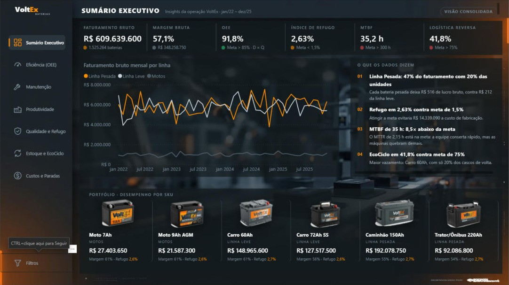
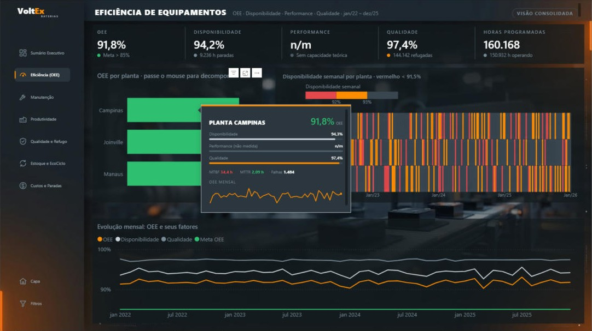
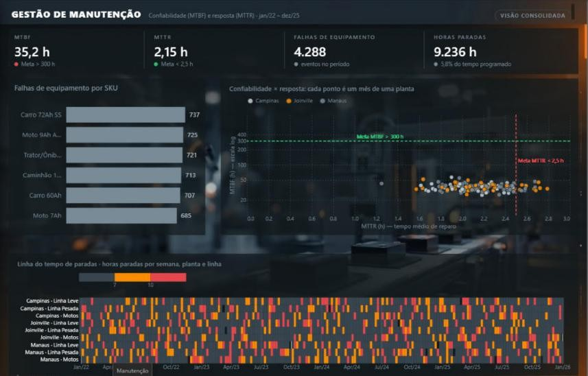
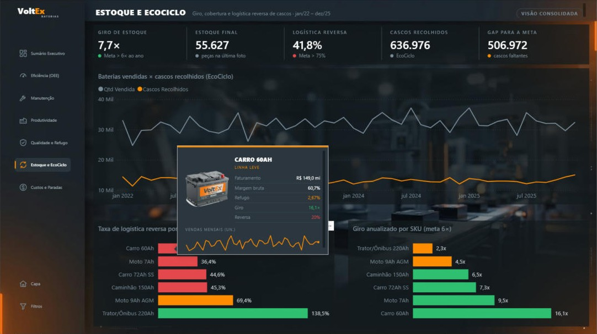
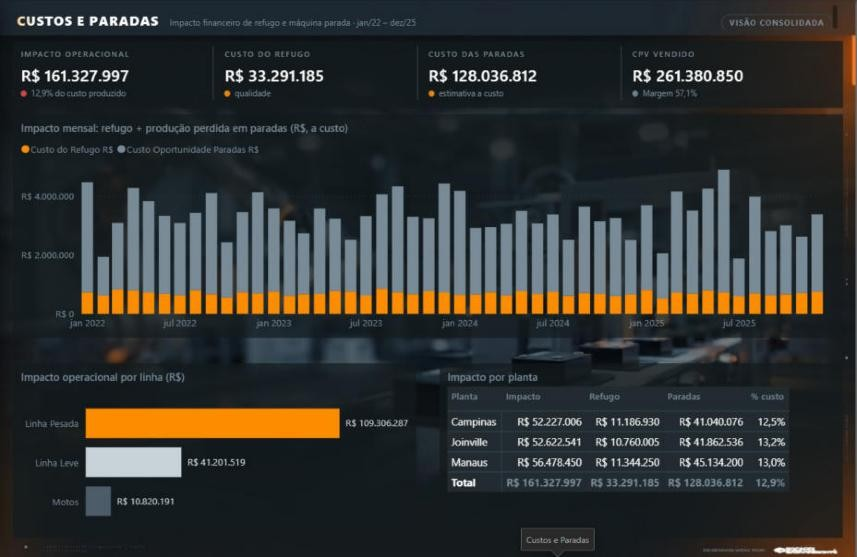
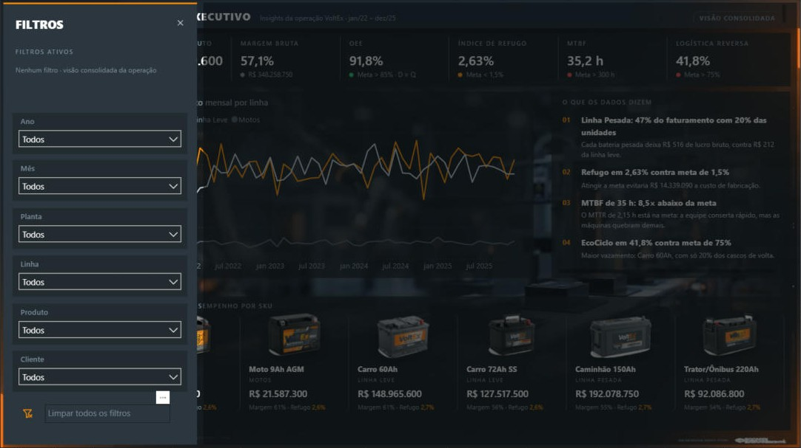

# ⚡ VoltEx Baterias — BI Industrial em Power BI (.pbip)

**Sistema integrado de performance para uma fábrica de baterias automotivas**: chão de fábrica, vendas, estoque e logística reversa (EcoCiclo) num único modelo, com KPIs industriais traduzidos em reais.


> Projeto de portfólio sobre uma base simulada da VoltEx Baterias S/A (empresa-modelo). Os números abaixo são calculados dessa base.

---

## O que o painel revela

| Achado | Número |
|---|---|
| **Linha Pesada** responde por 47% do faturamento com 20% das unidades | R$ 516 de lucro bruto por bateria vs. R$ 212 na Linha Leve |
| **Refugo** em 2,63% contra meta de 1,5% | R$ 33.291.185 perdidos · R$ 14.339.090 evitáveis na meta |
| **MTBF** de 35 h contra meta de 300 h | MTTR de 2,15 h está na meta: conserta rápido, quebra demais |
| **EcoCiclo** com 41,8% de retorno contra meta de 75% | Carro 60Ah, o mais vendido, recupera só 20% dos cascos |
| **Impacto operacional** (refugo + produção perdida em paradas) | R$ 161.327.997 · 12,9% do custo produzido |

---

## Telas

| | |
|---|---|
|  |  |
| **Sumário Executivo** — KPIs, insights automáticos e catálogo com fotos | **Eficiência (OEE)** — mapa de calor (Deneb) e tooltip com decomposição do OEE |
|  |  |
| **Manutenção** — quadrante MTBF × MTTR e linha do tempo de paradas (Deneb) | **Estoque e EcoCiclo** — tooltip com foto, KPIs e sparkline |
|  |  |
| **Custos e Paradas** — impacto financeiro por linha e planta | **Painel de filtros retrátil** — trilha de filtros ativos e slicers sincronizados |

---

## Como abrir

1. Clone o repositório num caminho curto e local (ex.: `C:\BI\voltex`). Evite OneDrive e caminhos longos (limite de 260 caracteres do Windows).
2. Abra `VoltEx.pbip` no Power BI Desktop (com a pré-visualização de PBIP/TMDL/PBIR ativada).
3. Em **Transformar dados › Editar parâmetros**, aponte **CaminhoBase** para `data\Base_VoltEx_Dashboard_Completo.xlsx` no seu clone.
4. Clique em **Atualizar**.
5. Na primeira abertura, o Desktop baixa do AppSource os visuais **HTML Content** e **Deneb** (requer login na conta Power BI).

---

## Arquitetura

```text
voltex/
├── VoltEx.pbip
├── VoltEx.SemanticModel/      modelo em TMDL
│   └── definition/tables/     Dim_Calendario · Dim_Produto · Dim_Cliente · Dim_Fabrica
│                              Fato_Vendas · Fato_Producao · Fato_Coleta_Cascos · Fato_Estoque_Mensal
│                              _Medidas (70 medidas em pastas)
├── VoltEx.Report/             relatório em PBIR (capa + 7 abas + 2 tooltips, 14 indicadores)
├── data/                      base Excel de origem
├── assets/                    fotos dos produtos, recortes, fundos e marca
└── docs/                      guia de construção, case study, brandbook, KPIs, planos de negócio
```

**Star Schema** com um único calendário ligado de forma **ativa** às quatro fatos. Como as fatos não se cruzam, um só filtro de período atravessa toda a operação sem `USERELATIONSHIP`.

### Regras de modelagem

| Item | Decisão |
|---|---|
| OEE | Disponibilidade × Performance × Qualidade, com Performance = 100% declarada (a base não tem capacidade teórica por linha) |
| MTBF / MTTR | Horas operando ÷ falhas / horas paradas ÷ falhas, sempre razão de somas |
| Estoque | Semi-aditivo: `Estoque Final` usa a última foto do período; `Giro Anualizado` normaliza para 12 meses |
| Logística reversa | Fica em branco com filtro de planta, porque a coleta de cascos não tem esse grão |
| Fotos | WebP base64 embutido em `Dim_Produto[Imagem_Base64]`, sem dependência de hospedagem |

### KPIs e metas

| KPI | Meta |
|---|---|
| OEE | > 85% |
| MTBF | > 300 h |
| MTTR | < 2,5 h |
| Índice de refugo | < 1,5% |
| Giro de estoque | > 6× ao ano |
| Logística reversa | > 75% |

---

## UX / UI

- Dark mode industrial: Grafite `#232B32` e Laranja Energético `#FF8C00` reservado para sinalizar.
- Fundos desenhados fora do Power BI; visuais sem caixa, borda ou sombra (tema JSON).
- Cabeçalhos, faixas de KPI, insights, catálogo e tooltips em **HTML Content** com animações CSS.
- Capa com camada animada de linhas de energia sobre as baterias.
- 4 visuais **Deneb / Vega-Lite**: mapa de calor de disponibilidade, quadrante MTBF × MTTR, linha do tempo de paradas e bullet de refugo vs. meta.
- Painel de filtros retrátil por indicadores (bookmarks) com trilha de filtros ativos.

Detalhes completos em [`docs/VoltEx_Guia_Construcao_e_Case_Study.md`](docs/VoltEx_Guia_Construcao_e_Case_Study.md).

---

## Stack

Power BI Desktop (.pbip · TMDL · PBIR) · DAX · Power Query M · Deneb / Vega-Lite · HTML Content · CSS · Git

---

<p align="right">
  <sub>Desenvolvido por:</sub><br>
  
</p>
